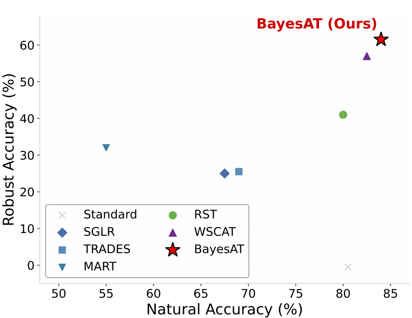
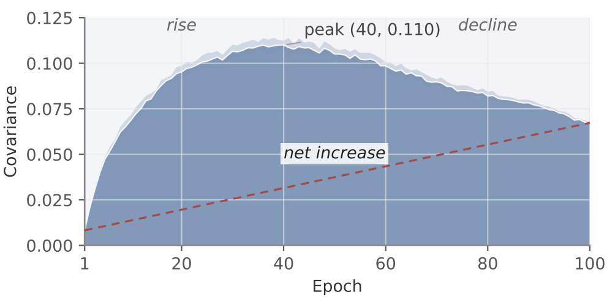
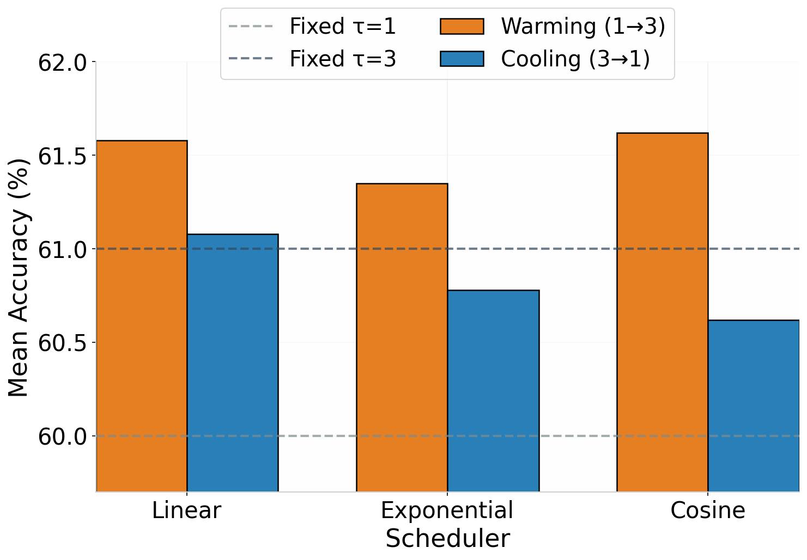

# BayesAT: Bayes-Guided Progressive Distillation for Semi-Supervised Adversarial Training

[]()
[]()
[]()

Official implementation of **"BayesAT: Bayes-Guided Progressive Distillation for Semi-Supervised Adversarial Training"** (NeurIPS 2026, Poster).

<p align="center">
  
</p>

## 📰 News

- **2026-09:** BayesAT has been accepted to **NeurIPS 2026** (poster). 🎉

## 💡 Introduction

Existing Semi-Supervised Adversarial Training (SSAT) methods typically rely on static supervision—either hard pseudo-labels or soft labels with a fixed temperature. This implicitly assumes a stationary learning process, which fails to accommodate the student's evolving capability, especially when the teacher's performance plateaus and becomes over-confident.

BayesAT reframes SSAT as knowledge distillation relative to a Bayes reference and formalizes a **stage-dependent bias-variance tradeoff**. Guided by this analysis, BayesAT dynamically balances the tradeoff through two complementary mechanisms:

1. **Variable-Temperature Progressive Distillation** — a low-to-high temperature warming schedule that transitions from sharp supervision (for decision-boundary establishment) to smooth supervision (for variance control and inter-class exploration).
2. **Confidence-Adaptive Sample Reweighting** — a sample-wise mechanism that uses teacher confidence as a practical proxy to down-weight ambiguous supervision.

The two mechanisms operate along complementary axes (stage-wise vs. sample-wise), pushing the accuracy–robustness frontier on CIFAR-10/100 and ImageNet-200:

| Method    | Natural | FGSM  | PGD   | CW    | AA    | Mean  |
|-----------|--------:|------:|------:|------:|------:|------:|
| Standard  | 78.04   | 6.55  | 0.00  | 0.00  | 0.00  | 16.92 |
| SGLR      | 67.33   | 29.47 | 24.94 | 24.68 | 23.58 | 34.00 |
| TRADES    | 69.13   | 29.72 | 25.56 | 25.62 | 24.56 | 34.92 |
| MART      | 54.48   | 33.60 | 32.18 | 27.32 | 26.02 | 34.72 |
| MT        | **86.12**   | 12.60 | 0.00  | 0.00  | 0.00  | 19.74 |
| RST       | 79.95   | 47.95 | 40.86 | 40.83 | 38.22 | 49.56 |
| WSCAT     | 80.10   | 58.02 | 56.47 | 52.36 | 50.94 | 59.58 |
| **BayesAT (Ours)** | 81.36 | **61.20** | **60.95** | **53.58** | **52.58** | **61.94** |

*Robust accuracy (%) on CIFAR-10 under AutoAttack (AA), mean over three random seeds. Full results on CIFAR-100 and ImageNet-200 are in the paper.*

## 🔑 Key Idea: stage-dependent supervision

Our generalization bound shows that the variance-related quantities depend on the evolving student state. Direct measurement confirms a **stage-dependent** (rise–peak–decline) pattern rather than a globally monotonic one, and a fixed temperature need not preserve the same bias-variance balance throughout training. The warming schedule is therefore a simple **stage-adaptive approximation** to this evolving trade-off.

<p align="center">
  
</p>

## 🧩 Framework

<p align="center">
  
</p>

**Phase 1 (Teacher training):** the Mean Teacher is trained on labeled and unlabeled data and then fixed.
**Phase 2 (Student training):** the student is adversarially trained with temperature-adjusted soft pseudo-labels and confidence-adaptive reweighting.

## 🔬 Why warming, not cooling?

Within the same framework, warming schedules consistently outperform cooling and fixed-temperature alternatives, particularly under stronger attacks:

<p align="center">
  
</p>

## 🛠️ Requirements

### Dependencies

```txt
python==3.10
coloredlogs==15.0.1
matplotlib==3.10.6
numpy==2.0.1
pandas==2.3.3
Pillow==11.3.0
PyYAML==6.0
torch==2.9.0+cu126
torchattacks==3.5.1
torchvision==0.24.0+cu126
tqdm==4.67.1
```

### Verified hardware environment

- Ubuntu 22.04.5 LTS
- CUDA 12.6
- NVIDIA L20 (48 GB)

## 🚀 Quick Start

BayesAT trains in two phases:

**Step 1 — Train the Mean Teacher:**
```bash
python tunner.py
```

**Step 2 — Switch to BayesAT:** in the config, set the method to BayesAT and the training entry from `train_mt` to `train_BayesAT`, then run again:
```bash
python tunner.py
```

> The pretrained teacher weights from Step 1 are loaded automatically by `train_BayesAT`.

## 📖 Citation

If you find this work useful, please cite:

```bibtex
@inproceedings{guo2026bayesat,
  title={BayesAT: Bayes-Guided Progressive Distillation for Semi-Supervised Adversarial Training},
  author={Guo, Yimo and Zhang, Lilin and Li, Penglin and Hao, Jinhui and Liu, Xianggen},
  booktitle={Fortieth Conference on Neural Information Processing Systems (NeurIPS)},
  year={2026}
}
```

## 🙏 Acknowledgements

This work was supported by the National Key R&D Program of China (2024YFB3312503), the Science and Technology Major Project of Sichuan Province (2024ZDZX0003, 2025ZDZX0140), and the Fundamental Research Funds for the Central Universities (2026SCUQJTX001).
